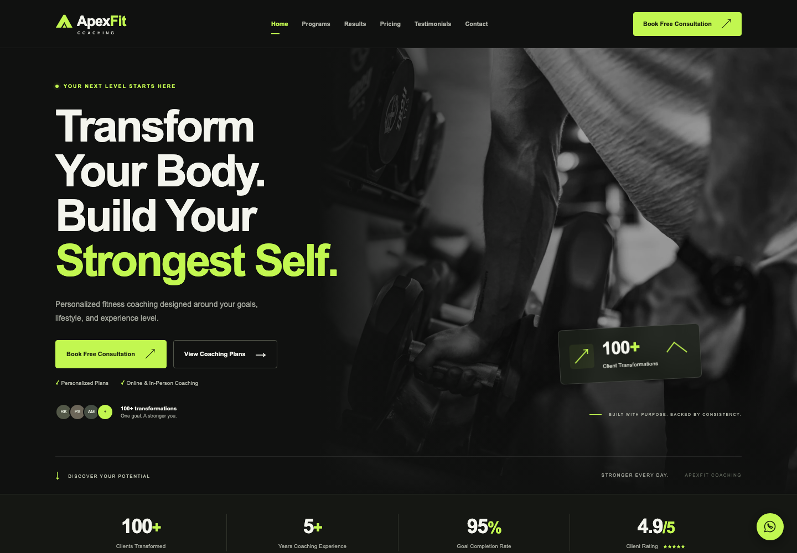
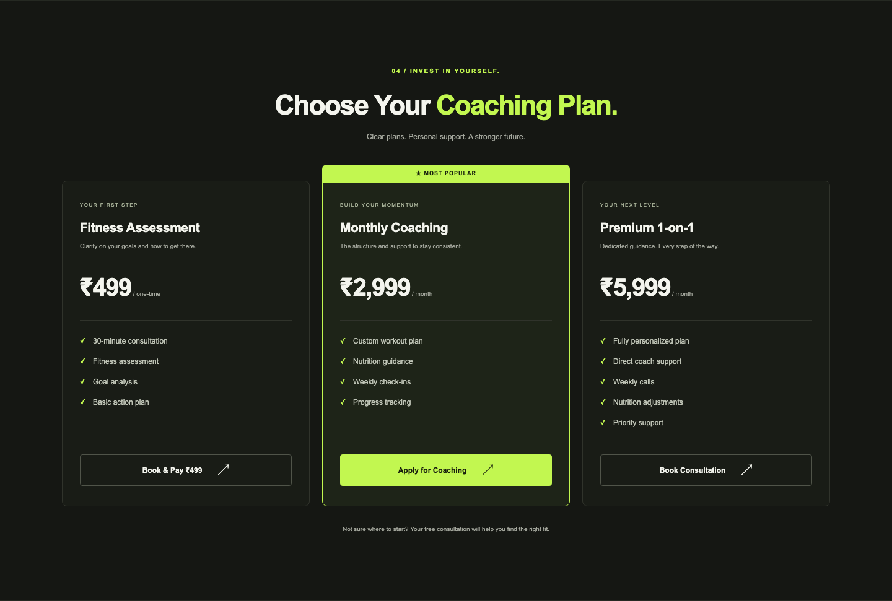
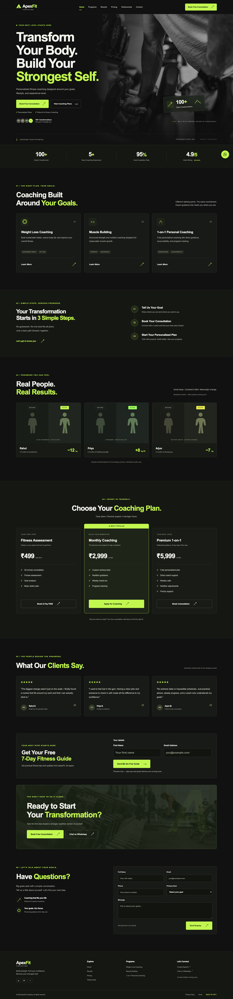
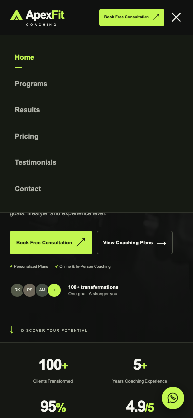

# ApexFit Coaching

**A custom fitness coaching website with a responsive landing page and a separate admin interface.**

ApexFit presents coaching programs, pricing and consultation options in a dark, lime-accented design. Built with HTML, CSS and vanilla JavaScript, it combines a focused public experience with an administration interface designed to display leads, bookings and payments.



> **Project status:** The public page was checked locally in Chromium with external requests blocked. Booking, payment, authentication, newsletter delivery and backend synchronization have not been verified end to end. Screenshots show the existing design: headline statistics are unverified demo copy, and transformations and testimonials are explicitly illustrative.

## Highlights

- **Complete coaching presentation:** programs, a three-step coaching journey, pricing, illustrative results and testimonials, newsletter and enquiry sections.
- **Responsive layout:** adaptive grids, a mobile navigation menu and layouts for desktop, tablet and narrow mobile screens.
- **Custom visual design:** WebP hero photography, a gym background, SVG branding, card treatments and scroll reveal animations.
- **Accessibility provisions:** semantic sections, skip links, form labels, visible keyboard focus and reduced-motion styles. Accessibility compliance has not been audited.
- **Admin interface:** login screen, overview cards, a weekly lead chart, searchable and filterable tables, and record detail dialogs. These are implemented in source; authenticated behavior remains untested.
- **External service wiring:** consultation, application, enquiry and payment entry points, with the verification limits documented below.

## Preview gallery

These are genuine captures of the local website, with all external requests blocked before navigation. No customer records, credentials or completed transactions were used. Existing illustrative-content disclaimers remain in the full-page capture.

### Desktop



The displayed prices and payment buttons are part of the interface; this capture does not demonstrate a completed purchase or booking.

<details>
<summary>View the full desktop page</summary>



</details>

### Mobile

| Coaching introduction | Navigation open |
| --- | --- |
|  |  |

## Technology

| Layer | Implementation |
| --- | --- |
| Markup | HTML5 with semantic sections and native forms/dialogs |
| Styling | Custom CSS, Grid, Flexbox, media queries and CSS variables |
| Interaction | Vanilla JavaScript, IntersectionObserver and matchMedia |
| Admin client | Fetch API, response normalization, pagination and sessionStorage |
| Assets | Local WebP, JPEG and SVG files; system fonts |
| Build requirements | No package installation, compilation or framework required |

The repository contains the frontend. The external Worker API, automation workflows and service-side configuration are not included.

## Project structure

```text
.
├── index.html                 # Public coaching website
├── styles.css                 # Public styles and responsive layouts
├── script.js                  # Public interactions and newsletter handler
├── admin/
│   ├── index.html             # Admin login interface
│   ├── dashboard.html         # Admin dashboard shell
│   ├── admin.css              # Admin styles
│   └── admin.js               # Authentication client and record display
├── assets/
│   ├── athlete.webp           # Hero image
│   ├── athlete.jpg            # Alternative image asset
│   ├── gym.jpg                # CTA background
│   └── favicon.svg
├── docs/screenshots/          # Genuine local website captures
└── README.md
```

## Local setup

Use an existing Python 3 installation, or an equivalent static server. From the repository root:

```sh
python3 -m http.server 8000 --bind 127.0.0.1
```

Open `http://127.0.0.1:8000/` in a browser. Stop the server with `Ctrl+C`. This is a local development address, not a hosted demo. No npm install or build command is needed.

**External requests:** normal browsing loads configured third-party scripts, including analytics. Forms and service buttons can contact external systems. For an isolated preview, block every request outside the local server before opening the page, as was done for the screenshots. Binding the server to loopback alone does not block outbound browser traffic.

## Usage

- Browse programs and pricing, or use the navigation to move between sections.
- On smaller screens, open the menu to access the same page sections.
- Consultation, application, payment and chat controls point to configured external services. Do not use them for test submissions against live accounts.
- The admin login page is at `/admin/index.html`. It requires a compatible external backend and authorized credentials; no demo password is provided. The dashboard requests lead, booking and payment data after a session token is present.
- Admin enquiry handling is not connected. The reply dialog is a preview and does not send or save messages.

## Integration status

The following is verified from source inspection, **not successful live service testing**.

| Service | Present in the frontend | Verification limit |
| --- | --- | --- |
| Cal.com | Consultation embed and booking buttons | Availability and booking completion untested |
| Tally | Coaching application popup configuration | Form loading and submission untested |
| Razorpay | Hosted assessment payment link | No payment tested; payment synchronization is marked unconfirmed |
| Formspree | Direct POST action on the enquiry form | Submission and delivery untested |
| WhatsApp | Outbound chat links | No chat opened or message sent |
| Microsoft Clarity | Analytics loader | Requests blocked during review; collection and masking unverified |
| n8n | Newsletter POST handler targeting a test webhook | Workflow execution and guide delivery unverified |
| Worker API / Airtable | Admin login and record-fetching client; management shortcuts | Backend source absent; authentication, authorization and synchronization untested |
| Gmail | Admin management shortcut | A link only; no email API integration demonstrated |

## Configuration

There is no environment-variable loader or `.env.example` in this project. Configuration is currently embedded in the frontend files:

| Location | Configuration categories | Safe documentation placeholders |
| --- | --- | --- |
| `index.html` | Booking target, application form, payment link, enquiry endpoint, chat destination and analytics project | `<BOOKING_TARGET>`, `<APPLICATION_FORM_ID>`, `<PAYMENT_LINK>`, `<ENQUIRY_ENDPOINT>`, `<CHAT_DESTINATION>`, `<ANALYTICS_PROJECT_ID>` |
| `script.js` | Newsletter webhook | `<NEWSLETTER_WEBHOOK_URL>` |
| `admin/admin.js` | Worker API base and management shortcuts | `<ADMIN_API_BASE>`, `<MANAGEMENT_URL>` |
| `admin/dashboard.html` | Analytics dashboard shortcut | `<ANALYTICS_DASHBOARD_URL>` |

These placeholders describe configuration locations; they are not supported environment-variable names. No private endpoints, account identifiers or contact details are reproduced here. Keep passwords, service API keys and payment secrets on the backend, never in public HTML or JavaScript.

## Local verification

The documentation capture review used an existing Chromium installation in an isolated profile, a loopback-only static server and request interception that allowed only the required local page, scripts, styles and images.

- Checked widths: **1440, 768, 390 and 320px**.
- No document-level horizontal overflow was detected at those widths.
- Local hero imagery loaded and all observed reveal elements became visible.
- The mobile navigation opened and closed at 390px.
- No uncaught page JavaScript exceptions were observed during capture. Third-party resources were deliberately blocked.
- No forms, bookings, payments, admin login or external workflows were exercised.

These checks cover the local public page in Chromium. They are not cross-browser certification, an accessibility audit, a performance benchmark or evidence of production readiness.

## Known limitations

- Some preview-only text and comments conflict with current code: JavaScript enables the newsletter form, analytics is configured to load, and several controls link to external services.
- The newsletter uses a test webhook; reliable subscription handling and fitness-guide delivery are unverified.
- Testimonials and transformation stories are illustrative. Headline client counts, experience, completion rates and ratings have no supporting evidence in this repository.
- Admin data and authentication depend on an external backend. Its authorization, expiry enforcement, rate limiting and security configuration cannot be assessed from this frontend.
- Admin enquiries are unconnected; replies are a UI demonstration only. Payment synchronization is unconfirmed.
- Privacy and terms dialogs contain placeholder information and need reconciliation with the configured services before a public launch.
- No automated test suite, hosting configuration or verified public deployment URL is included.

## Credits and licensing

No license file is included. The website footer states “All rights reserved”; an open-source license or permission to reuse the project should not be inferred.

The source and usage rights for the bundled photographs are not documented in the repository. Confirm attribution and licensing before redistributing them or reusing them in client work. No image license or third-party endorsement is claimed here.
